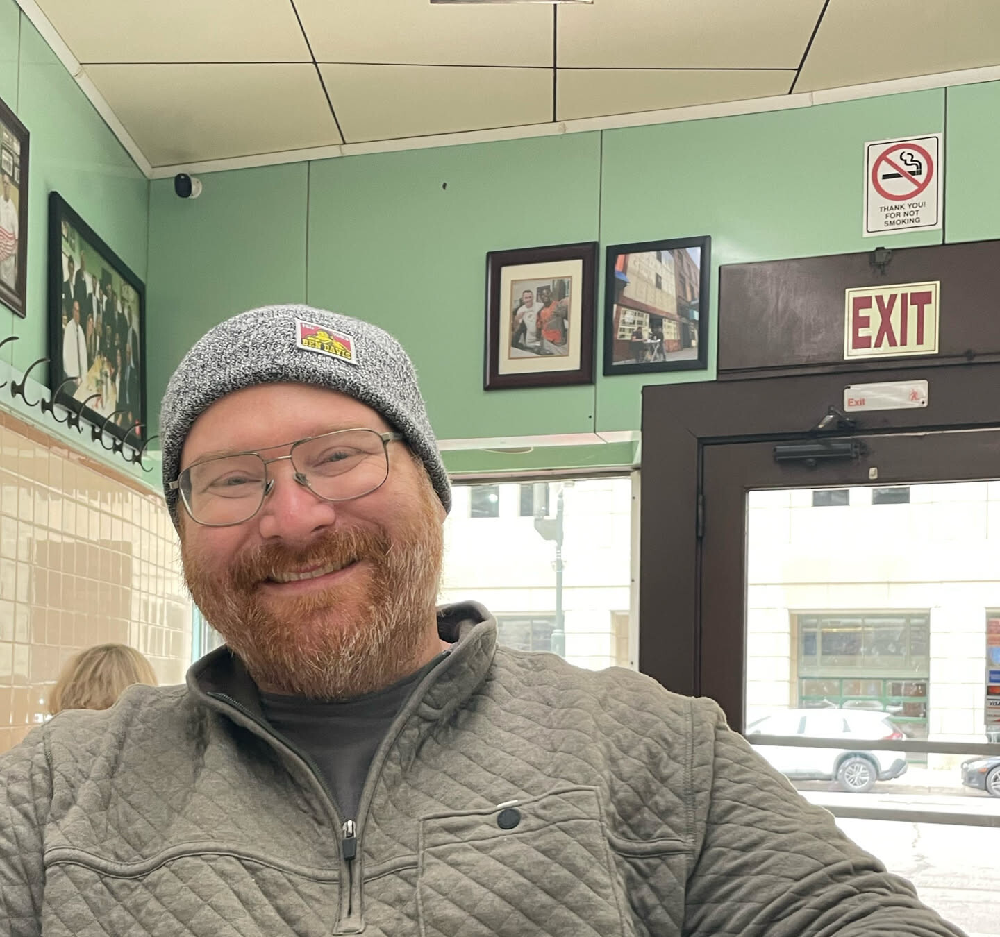

+++
date = '2026-02-07T21:40:37-08:00'
draft = false
title = 'About'
description = "Hunter Mills is a Senior Machine Learning Engineer at Keysight Technologies working on finance and supply chain. He has a decade of experience building clinical AI pipelines, edge computer-vision models, and synthetic patient datasets. He holds a master's from Stanford and a double-major in Physics and Mathematics from Sonoma State. Beyond tech, he gardens, plays tabletop RPGs, and crafts generative music."
+++

Hey, I’m Hunter. I’m a senior machine learning engineer at Keysight Technologies, where I work on finance and supply-chain problems. I’ve spent the better part of a decade building models, data pipelines, and production ML systems. I grew up in the Bay Area, earned a master’s in Computational & Mathematical Engineering at Stanford, and did a double-major bachelor’s in Physics and Mathematics at Sonoma State. That quantitative background has carried me through academia, industry, and a few space-related projects.

Much of my earlier work was in clinical research: pipelines that let hospitals watch for data drift across sites, edge-deployed computer-vision models that cut hardware costs, and synthetic-patient datasets that protect privacy while keeping the research moving. I’ve worked with electronic health records, clinical text, and ECG signals to study interstitial lung disease, pulmonary hypertension, traumatic brain injury, and dementia. Some of that work has appeared in JAMA Network Open, Nature Aging, and Chest, and led to collaborations with pharma companies.

Before all of that, I got to work on the first batch of PocketQube satellites while at Sonoma State.

I like systems that are reproducible, inspectable, and useful beyond a notebook. My recent personal projects include a solar-powered backyard weather station that now keeps an eye on air quality too, and small tools that bring probability and interpretable modeling to Dungeons & Dragons. I also care about privacy and self-hosting. The animated background on this site, for instance, is a real-time strange-attractor simulation I wrote myself.

Away from the keyboard, my garden remains one of my favorite places to be, even though it hasn’t made it into my posts. Beets are my favorite; there’s something satisfying about watching them go from seed to plate. On weekends I’m usually rolling dice in a monthly D&D campaign or arguing over a board game. I also write generative music that reacts to ambient sound and environmental data, so no two listens are quite the same.

I’m not one for buzzwords. I like clear, data-driven answers, and I’ll say so when I don’t know something. If you’re working on a hard problem and want a straight answer, feel free to reach out.
