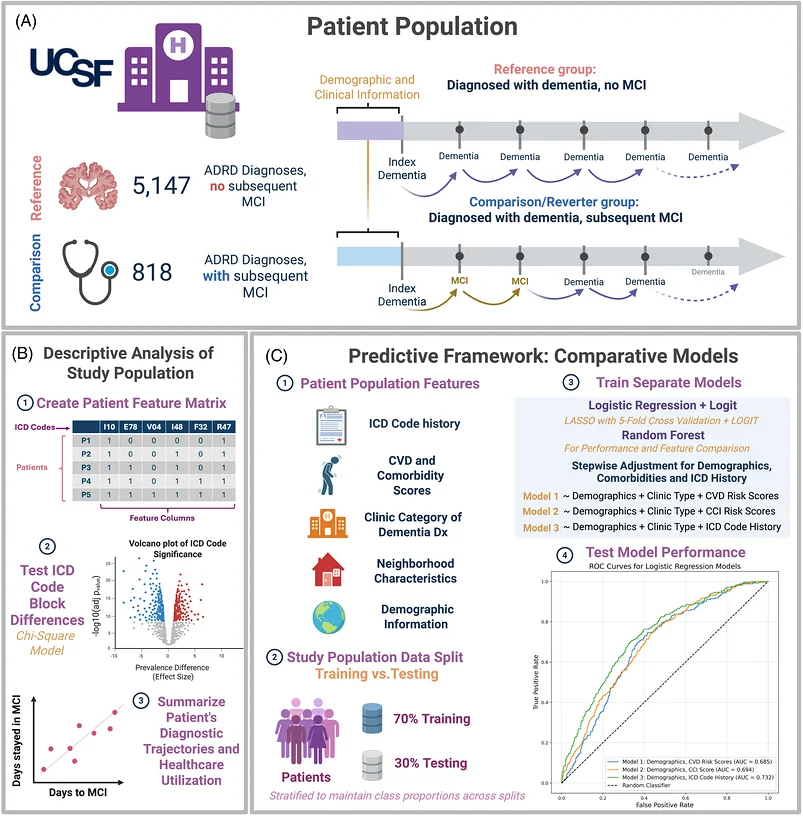
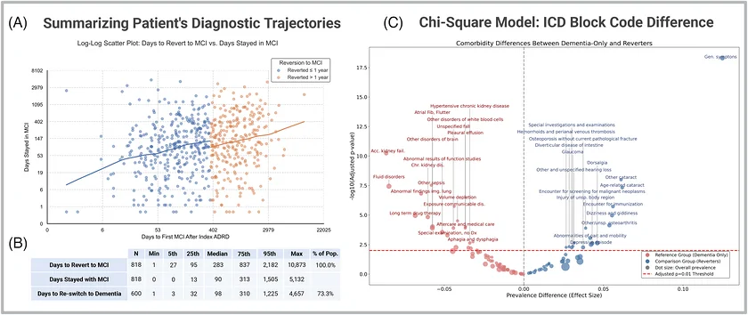
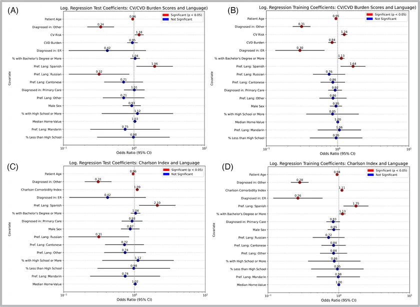
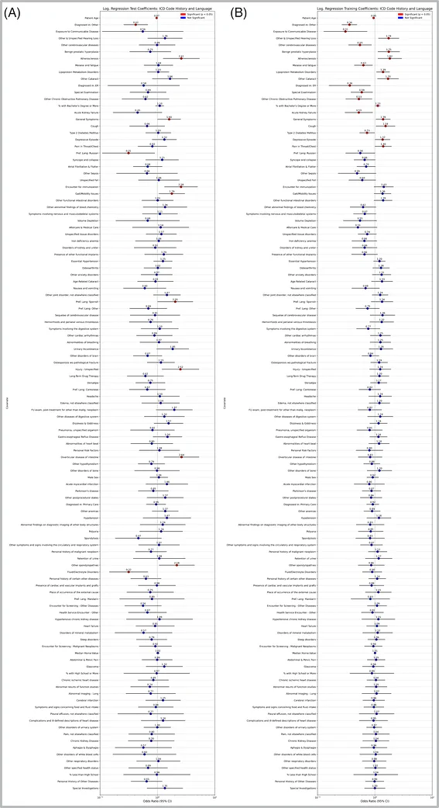
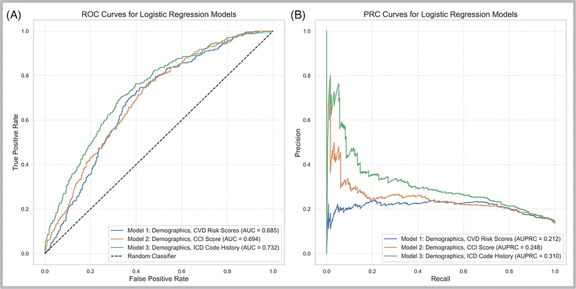
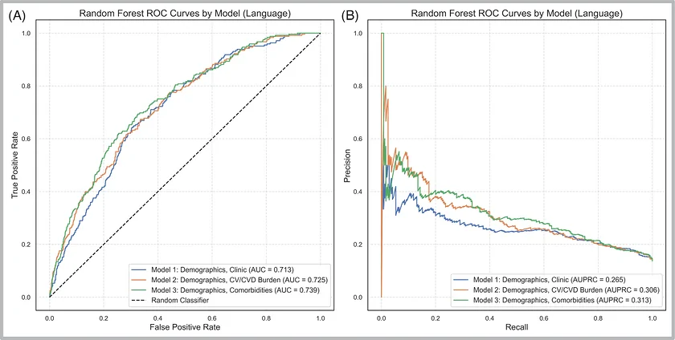

+++ 
draft = false
date = 2026-11-01T09:00:00-07:00
title = "Diagnostic Reversion in Dementia Care: A Real-World Analysis of Mild Cognitive Impairment Diagnoses After Dementia in a Large Electronic Medical Record System"
description = "A full summary of our Alzheimer's & Dementia study of diagnostic reversion among 5,965 UCSF patients. Nearly one in seven patients received an MCI diagnosis after dementia, and 73.4% of those reverters later returned to dementia. Group LASSO logistic regression and random forests identified age, preferred language, care setting, cardiovascular risk, and comorbidity burden as predictors, revealing diagnostic instability shaped by clinical and social factors."
slug = ""
authors = ["Hunter Mills"]
tags = []
categories = ["Publication Summary"]
externalLink = ""
series = []
+++
[Publication Link](https://doi.org/10.1002/dad2.70523)

## Why Look at “Diagnostic Reversion”?

Mild cognitive impairment (MCI) is usually framed as a precursor to dementia. So when an electronic health record (EHR) shows dementia first and MCI later, the diagnostic trajectory deserves attention. The original dementia diagnosis may have been premature, the later MCI diagnosis may be incorrect, or the patient's presentation may genuinely fluctuate near the boundary between the two categories.

Most earlier work examined reversion from MCI to normal cognition or the stability of an initial diagnosis. We studied the less-explored reverse sequence—**dementia followed by MCI**—to measure how often it occurs, what happens next, and which clinical and social factors are associated with it.

## Study Overview

* **Cohort:** 5,965 UCSF Health patients aged 50 or older with an incident dementia diagnosis between 1988 and 2024. Records from UCSF's legacy STOR system and its current Epic-based EHR were integrated in the de-identified Caboodle data warehouse.
* **Reference group:** 5,147 patients (86.3%) had no subsequent MCI diagnosis.
* **Reverters:** 818 patients (13.7%) received an MCI diagnosis after their initial dementia diagnosis.
* **Care setting:** The index diagnosis was categorized as coming from a dementia specialty clinic, primary care/internal medicine, the emergency department, or another specialty clinic.
* **Clinical history:** ICD-9/ICD-10 diagnoses recorded before the index dementia diagnosis were grouped into 101 ICD blocks present in at least 5% of patients, reduced from 1,931 unique blocks.
* **Other predictors:** Age, sex, preferred language, neighborhood education and home value, cardiovascular disease burden, cardiovascular risk factors, and Charlson Comorbidity Index (CCI).

|Figure 1: Cohort definition, descriptive analyses, and comparative modeling framework. The reverter pathway can include a later return to dementia.|
|:---:|
||

## Analytical Pipeline

1. **Descriptive comparison:** Chi-squared tests with Benjamini–Hochberg correction identified ICD blocks whose pre-index prevalence differed between groups.
2. **Trajectory analysis:** We measured time from dementia to MCI, time spent with the MCI diagnosis, subsequent return to dementia, and health-system use.
3. **Predictive modeling:** A stratified 70/30 train-test split preserved the approximately 14% reversion rate. All feature selection and threshold tuning were performed on the training set.
4. **Logistic regression:** Group LASSO with five-fold cross-validation selected groups of features; standard logistic regression was then refit to estimate odds ratios and confidence intervals.
5. **Random forests:** Matched models tested whether nonlinear methods improved discrimination and provided complementary feature-importance rankings.
6. **Model configurations:** Each approach used (a) cardiovascular burden and risk scores, (b) CCI, or (c) ICD-block history, together with demographics and clinic type. Sensitivity analyses replaced preferred language with race/ethnicity because the two were correlated.

## Reversion Was Usually Not the End of the Diagnostic Story

Among the 818 reverters:

|Trajectory measure|Result|
|:---|:---|
|Median time from index dementia diagnosis to first MCI diagnosis|**283 days** (IQR 95–837)|
|Median time spent with the MCI diagnosis before another change|**90 days** (IQR 13–313)|
|Patients who later received a second dementia diagnosis|**600 of 818 (73.4%)**|
|Median time from MCI to that second dementia diagnosis|**98 days** (IQR 32–310)|

The log–log plots in Figure 2A show a weak positive nonlinear relationship between time to reversion and time spent in MCI, with wide variation across patients. Figure 2B summarizes just how often the MCI interval was temporary. This is the strongest descriptive evidence that reversion frequently represents **diagnostic instability or reconsidered uncertainty**, rather than sustained cognitive improvement.

Reverters also had longer post-index follow-up, more recorded diagnoses, more unique conditions, and more visit days. Greater engagement with the health system may create more opportunities for diagnostic revision and is an important context for interpreting the associations.

|Figure 2: Diagnostic trajectories and pre-index ICD-block differences. Panel C shows 39 significantly different blocks; codes on the right were more prevalent among reverters.|
|:---:|
||

## Which Factors Predicted Reversion?

The held-out test-set models showed consistent associations across the cardiovascular and CCI specifications:

|Predictor|Held-out test-set association|
|:---|:---|
|Older age|Lower odds: OR 0.96 per year (95% CI 0.94–0.98)|
|Spanish-language preference|Higher odds: OR 1.96 (1.08–3.53) in the cardiovascular model; OR 2.10 (1.17–3.78) in the CCI model|
|Higher cardiovascular risk score|Higher odds: OR 1.18 (1.03–1.36)|
|Higher CCI|Higher odds: OR 1.09 (1.05–1.14)|
|Index diagnosis in another specialty clinic|Lower odds: OR 0.34 (0.22–0.52) and OR 0.31 (0.20–0.47), respectively|
|Russian-language preference|Lower odds: OR 0.32 (0.12–0.85) and OR 0.31 (0.12–0.83), respectively|

Higher cardiovascular disease burden and emergency-department diagnosis were associated with lower odds in training, but those associations were not statistically significant in the test set. Neighborhood education predicted reversion in training but not testing, and median home value was not significantly associated in the test sets.

Figure 3 makes the train/test comparison explicit: several effects have consistent directions, but the held-out intervals are wider. That is a useful reminder to distinguish reproducible signals from associations supported only by the training data.

|Figure 3: Training- and test-set odds ratios for models using cardiovascular scores or CCI. Red markers indicate p < 0.05; the odds-ratio axes are logarithmic.|
|:---:|
||

## What the ICD Histories Added

The descriptive analysis found **39 ICD blocks** that differed significantly between groups after multiple-hypothesis correction.

* **More prevalent among reverters:** dizziness/giddiness, depressive episodes, osteoarthritis, cataracts, dorsalgia, and unspecified injuries.
* **More prevalent among patients who remained diagnosed with dementia:** chronic kidney disease, atrial fibrillation, fluid/electrolyte disorders, abnormal lung imaging, long-term drug therapy, brain disorders, and respiratory disorders.

The full ICD-history logistic model selected 116 predictors; 12 were statistically significant in the held-out test set. Higher odds of reversion were associated with atherosclerosis, fever, mobility problems, immunization encounters, unspecified injuries, diverticular disease, and other spondylopathies. These are not evidence that the conditions caused reversion. Instead, the broad pattern suggests that nonspecific symptoms, functional problems, and ongoing clinical contact can coincide with less stable diagnostic labeling. Chronic and advanced systemic illnesses tended to align with a stable dementia diagnosis.

|Figure 4: ICD-history model coefficients in the test and training sets. Many held-out confidence intervals are wide, reflecting limited power for individual diagnosis-level associations.|
|:---:|
||

## Model Performance: Modest Discrimination, Useful Interpretability

|Model family|AUROC|AUPRC|Performance after F1 threshold tuning|
|:---|:---|:---|:---|
|Logistic regression|0.69–0.74 across specifications|0.23–0.32|Sensitivity 0.65–0.75; F1 0.34–0.36|
|Random forest|0.72–0.74 across specifications|0.27–0.31|Sensitivity 0.29–0.56; precision 0.26–0.39; F1 up to 0.38|

The best language-adjusted curves shown in the figures were similar: the ICD-history logistic model reached AUROC 0.732 and AUPRC 0.310, while the corresponding random forest reached AUROC 0.739 and AUPRC 0.313. The random forest's tuned F1 was slightly higher, but not enough to overturn the practical advantage of interpretable coefficients.

At the default 0.5 probability threshold, the models produced no positive predictions. Tuning thresholds on the training data improved minority-class detection, but the modest precision–recall performance argues against treating these models as ready-made individual risk scores.

|Figure 5: Logistic-regression ROC and precision–recall curves. The ICD-history model performed best, but precision remained modest under class imbalance.|
|:---:|
||

|Figure 6: Random-forest ROC and precision–recall curves. Discrimination was comparable to logistic regression across matched feature sets.|
|:---:|
||

## What This Means for Practice

1. **A later MCI diagnosis should prompt diagnostic review, not assumptions.** It may reflect premature dementia labeling, an incorrect MCI label, fluctuating presentation, or a specialist's revised assessment.
2. **Language-concordant care deserves attention.** The Spanish-language association raises concern about communication and diagnostic assessment, but this study did not measure interpreter use, provider language proficiency, or cultural concordance, so it cannot identify the mechanism.
3. **Clinical complexity matters.** Cardiovascular risk and overall comorbidity burden may make cognitive assessment and diagnostic labeling harder, particularly when other conditions compete for clinical attention.
4. **Follow-up shapes what we observe.** Reverters had greater subsequent health-system engagement, making diagnostic revision partly a function of opportunities to revisit the label.
5. **Use the predictors to improve processes, not to automate judgment.** The authors' interpretation is that these signals are more useful for locating where diagnostic pathways need strengthening than for deploying an individual-level prediction tool.

## Limitations Worth Noting

* **No diagnostic gold standard:** Billing-oriented EHR fields cannot establish whether the dementia diagnosis, the MCI diagnosis, or both were clinically correct.
* **No notes or formal cognitive assessments:** The structured data could not distinguish true cognitive improvement from diagnostic uncertainty or coding variation.
* **Downstream consequences remain unknown:** The study did not assess whether reversion changed treatment, outcomes, or subsequent healthcare use.
* **Important context was unmeasured:** Medications, provider language proficiency, cultural concordance, family support, and individual education history were unavailable. Neighborhood education and home value are imperfect socioeconomic proxies.
* **Limited test-set power:** Only 13.7% of patients reverted, and some training-set associations did not replicate with statistical significance in testing.
* **Single-system cohort:** UCSF's urban, tertiary-care population may not represent other systems, and longitudinal histories may be incomplete for patients who received much of their care elsewhere.

## Bottom Line

Diagnostic reversion from dementia to MCI affected **13.7%** of this real-world cohort, and nearly three-quarters of reverters later returned to a dementia diagnosis. Age, preferred language, care setting, cardiovascular risk, comorbidity burden, and pre-existing diagnostic patterns all carried signal.

The central finding is not simply that diagnoses are sometimes “wrong.” It is that the MCI–dementia boundary can be unstable in routine care, and that instability is socially and clinically patterned. Better diagnostic pathways need longitudinal follow-up, language-concordant assessment, clinical notes and cognitive measures, and validation across health systems.

*Figures reproduced from Miramontes et al. (2026), [Alzheimer's & Dementia: Diagnosis, Assessment & Disease Monitoring](https://doi.org/10.1002/dad2.70523), under the CC BY-NC 4.0 license.*
