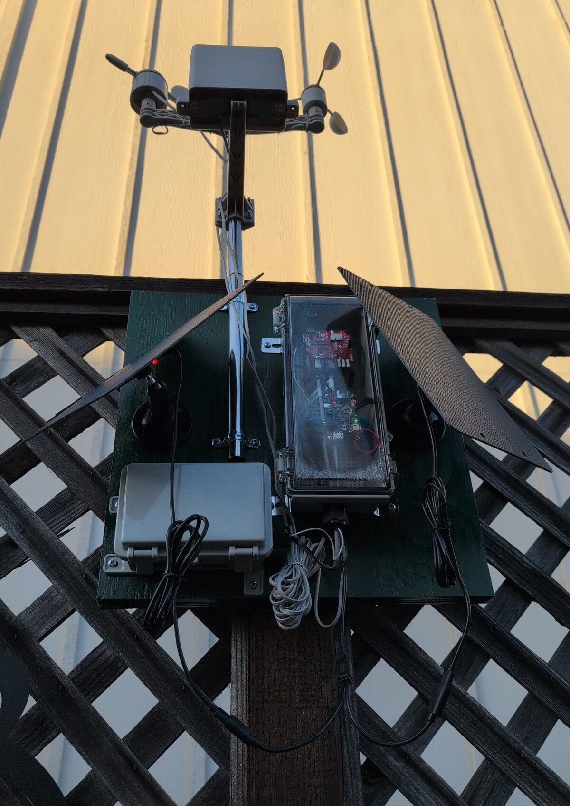
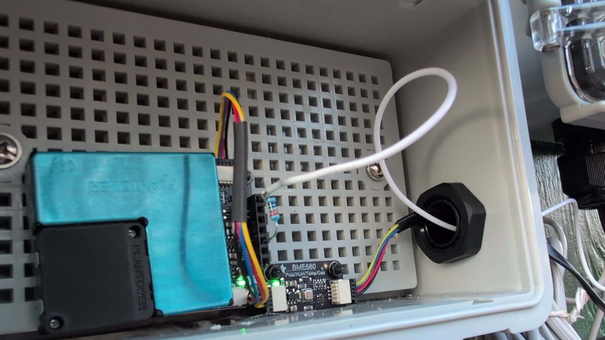

In [the original weather-station post](), the next steps were a separate environmental sensor, air-quality monitoring, and lower power consumption. In [the last update](), the station got battery telemetry and a fence mount, but the thermometer was still sitting beside a warm charger.

Those three planned upgrades are now installed. The station has a new auxiliary sensor box with open airflow, the [dashboard](https://weather.volundarhus.com) reports air quality, and the power budget has had some much-needed attention.

## Measuring the air instead of the electronics

An **Adafruit BME680** now handles temperature, humidity, pressure, and gas resistance. It lives in the auxiliary box, away from the ESP32 and solar charger, with airflow to the outside. The carrier board's original BME280 is still physically present, but the firmware no longer reads it.

This is the physical fix the temperature readings needed. The old arrangement was very good at measuring the inside of a warm enclosure. The new one at least gives the sensor a chance to measure the backyard.

It has not eliminated the problem. Despite the near-white box and open airflow, the BME680's temperature readings still run a bit high. Moving the sensor improved the measurement; it did not magically turn a homemade enclosure into a proper radiation shield.

The BME680 also provides a VOC-related gas-resistance measurement. That appears on the dashboard as a trend, not as a pretending-to-be-calibrated indoor air-quality score.

## Adding particulate matter and AQI

The other new sensor is an **Adafruit PMSA003I**, which measures PM1.0, PM2.5, and PM10. The dashboard now calculates a US EPA AQI from PM2.5 and shows the usual category colors, along with the particulate readings and BME680 gas resistance. The same data is available in Grafana and in the history charts.

This was the measurement I most wanted during fire season. Temperature and wind are interesting; smoke is often the reason I check the weather in the first place.

The AQI is calculated from the station's latest five-minute reading rather than the EPA's longer NowCast average. It should respond quickly to changing conditions, but it is a local, short-window measurement rather than a replacement for AirNow.

## The fan that would not turn off

The air-quality sensor also broke the power budget. Its fan draws about **100 mA**, and after installing the auxiliary box the battery lasted only about a day. Even when the solar panel had an opportunity to recharge the battery, the constantly running fan made rebuilding that charge much harder.

I had assumed the fan could be toggled over I2C. It cannot. The PMSA003I has a separate **SET** pin, and the breakout pulls that pin high by default. Leaving it unconnected means the fan runs, including while the ESP32 is booting, resetting, or asleep.

The fix required one more wire between the boxes, from SET to **GPIO16**, and a **330 Ω pull-down resistor** at the sensor breakout. The resistor makes the default state off instead of on. A larger resistor would have wasted less power while the fan was enabled, but would not reliably overcome the sensor's internal pull-ups. This is one of those problems where the firmware fix starts with a resistor.

The fan now runs for only **40 seconds in each five-minute window**: 30 seconds to stabilize and flush the sensor chamber, followed by about 10 seconds of sampling. The firmware averages roughly five samples, then puts the sensor back to sleep. That reduces the fan's duty cycle to about **13%**, and the pull-down keeps it off during resets and deep sleep too.

## Sleeping before the battery gives up

On November 4, the battery ran flat. The ESP32 remained powered but hung, and it stayed that way after the panel had recharged the battery until I pressed reset. A solar-powered station should be able to recover from cloudy weather without a human doing a tiny power-cycle ritual.

The new low-battery mode stops before reaching that state. After **two consecutive readings below 3.3 V**, the station spends up to 20 seconds trying to upload queued readings, turns the fan off, and enters deep sleep. It wakes every 20 minutes to check the battery before starting WiFi, and goes back to sleep until the battery reaches **3.6 V**. Then normal reporting resumes.

This is deliberately a low-battery shutoff rather than deep sleep between every normal reading. While the station is asleep, it takes no readings and does not count rain tips or wind. A gap in the data is not ideal, but it is better than a station that silently hangs and waits for me to notice.

The two changes work together: duty-cycling reduces the normal load, and deep sleep limits the damage when solar input still cannot keep up. The fan's pull-down is the small but important detail that keeps it off in both cases.

## What comes next

The next temperature iteration will use both environmental sensors: the auxiliary BME680 and the original BME280 on the carrier board. Both read high, but the BME280 reads much higher. I'll log both alongside another nearby source, then train a basic regression model to attempt to mitigate the remaining bias. That is not a substitute for good sensor placement, but two sensors with different amounts of self-heating and a nearby reference should make an interesting dataset.

I also want to see how the particulate sensor behaves over a longer run and find out whether the revised power budget is enough for winter.

The station is still very much a homemade instrument. But it now measures the outside air with sensors that are actually exposed to it, reports the smoke I care about, and has a fighting chance of recovering from a stretch of bad weather on its own.
