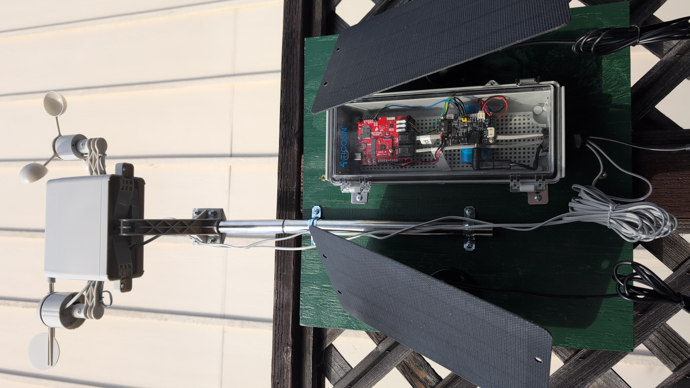
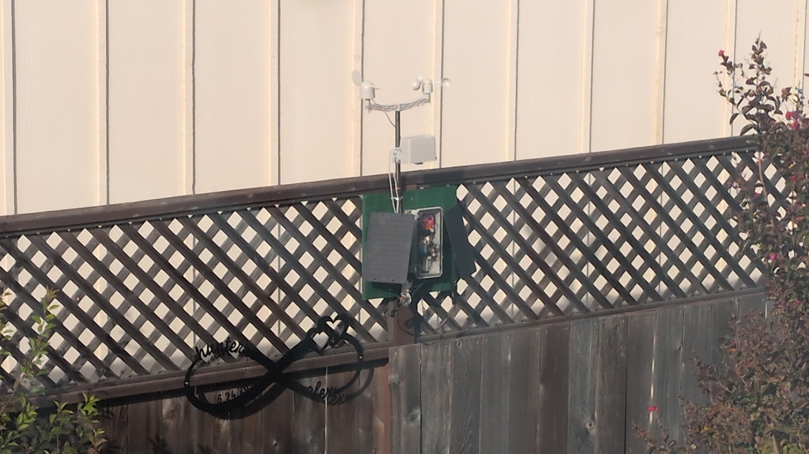

In [the last weather-station post](), I had a working dashboard and a pile of hardware that still looked like a science fair project. Two things have improved since then: the station can now tell me how its battery is doing, and the whole assembly is mounted on the fence.

## Knowing what the battery is doing

Solar power had been working, but "it hasn't died yet" isn't much of a monitoring strategy. The station now reads the battery voltage and charge state from the solar charger along with the weather sensors. The charger already exposes the cell voltage through a resistor divider, so this was mostly a matter of wiring that output to an ESP32 ADC pin and calibrating the reading against a multimeter.

The battery voltage now shows up on the [dashboard](https://weather.volundarhus.com), both as a current reading and as a chart over time. The dashboard also shows whether the panel is charging, the battery is full, or there's no solar input. While the battery is discharging, it gives a rough charge estimate too.

More importantly, the Pi sends an **ntfy** alert when the battery falls to 3.5 V, and another when it recovers. That should give me some warning before a run of cloudy days turns into an offline station. It also gives me useful data for deciding whether I actually need to add deep sleep before winter, rather than guessing.

## Moving outside properly

The other update was gloriously analog: a mounting board, some brackets, and screws. The meter assembly sits above the fence, with the electronics enclosure and solar panel fixed to the board below it. WiFi still reaches, the panel gets sun, and I no longer have to move a loose collection of parts around the yard.

My wife chose the green for the mounting board. This was the right call: it looks intentional and blends into the fence much better than the bare wood would have. Hardware projects are better when someone in the house has aesthetic standards.

## What's still wrong

The fence is a practical mounting spot rather than a meteorologically perfect one. Nearby surfaces can affect wind and temperature, and the original temperature problem is **not resolved**. The BME280 still sits on the carrier board inside the electronics enclosure, close to the solar charger. The charger radiates a surprising amount of heat, especially in the sun, so the temperature readings still run above the actual air temperature. A nicer mount hasn't fixed bad sensor placement.

## Next steps

The next hardware change will be a **separate environmental sensor**, mounted away from the charger and control electronics and closer to the elements. It needs a proper radiation shield of its own so it can measure the air rather than the inside of a warm box.

I'm also planning to add an **air-quality sensor**. During fire season, particulate matter is often the backyard measurement I care about most, and it belongs alongside temperature, humidity, pressure, wind, and rain on the dashboard.

But this is a much better version of the station. It's off the ground, it looks like it belongs there, and when the power budget starts getting tight, I'll know before it silently disappears.
